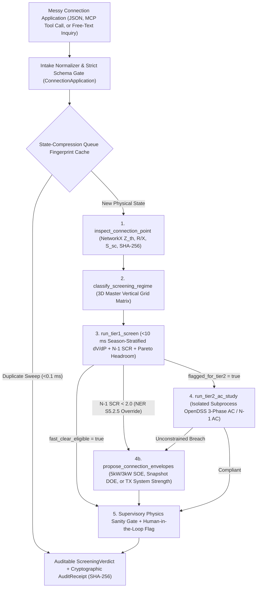

# Grid Connection Screening Agent (`rt-grid-screening-agent`)

<!-- mcp-name: io.github.omari91/rt-grid-screening-agent -->

[](https://pypi.org/project/grid-screen-mcp/)
[](https://github.com/omari91/rt-grid-screening-agent/actions/workflows/ci.yml)
[](LICENSE)

A deployable, physics-grounded **Agentic Grid Connection Screening Tool** spanning the full Australian vertical voltage continuum (**415 V LV → 11–20 kV MV → 132–500 kV NEM Transmission**).

Built as the operational software implementation of the PhD research framework (*Constraint-Decoupled Dominance across the Vertical Grid Continuum*), this package exposes a single deterministic physics core across **three interfaces**:

1. **MCP Server (`grid-screen-mcp`)** — Plug-and-play Model Context Protocol Interconnection Queue Gatekeeper (`stdio`, `streamable-http`, `sse`) for Claude Desktop, Cursor, Antigravity, and autonomous engineering workflows.
2. **FastAPI Service & Operator Compliance Dashboard (`grid-screen-api`)** — Structured JSON (`POST /v1/screen`), natural-language intake (`POST /v1/screen/intake`), live Interconnection Queue telemetry (`GET /v1/queue`), interactive HTML5 Compliance Dashboard (`GET /dashboard`), and zero-dependency SVG voltage & envelope plots (`POST /v1/screen/plot`, `POST /v1/screen/intake/plot`).
3. **CLI Agent (`grid-screen`)** — Instant terminal triage (`grid-screen triage` and `grid-screen ask` with `--study-type snapshot | time_series` and `--svg plot.svg`).

---

## Core Architecture: *"LLM Orchestrates, Physics Solves, Gate Bounds"*

Instead of acting as a generic chatbot wrapper, this tool operates as an **Interconnection Queue Backlog Gatekeeper** in front of real unbalanced 3-phase OpenDSS and `N-1` AC contingency solvers:



---

## Who is this for? (User Personas & Friction)

Standard LLM wrappers fail in power-systems engineering because language models guess voltages, confuse voltage-tier physics, or silently skip non-converged AC power flows. This agent was built to solve specific friction points for the humans and systems who actually run the grid.

### 1. The Connection Engineer (DNSP / TSO)
- **The Persona:** A mid-to-senior planning engineer processing grid connection applications (e.g., Ausgrid, UK Power Networks, 50Hertz, Transpower).
- **The Daily Reality:** Drowning in connection requests (such as the 67 GW NEM queue). Manual AC power-flow studies take hours or days per application, forcing reliance on static worst-case heuristics.
- **The Friction:**
  - **"Safe" Bias:** Viable projects get rejected or hit with massive upgrade costs because engineers lack time to evaluate conditional operating envelopes.
  - **License Risk:** Standard AI (like raw ChatGPT) is unusable because a single hallucinated voltage puts an engineer's professional license and grid safety on the line.
- **How this Agent Solves It:** *"LLM Orchestrates, Physics Solves"* guarantees the LLM never guesses. Requests route to deterministic Python/OpenDSS solvers, giving a `<10 ms` fast-pass for obvious cases, an isolated 3-phase AC study when needed, and a mandatory `"requires_human_review"` flag for `>=132 kV` or non-trivial connections.

### 2. The Industrial Developer / EPC Contractor
- **The Persona:** A project developer sizing a hyperscale data centre, BESS, or commercial EV hub.
- **The Daily Reality:** Needs to verify connection viability and reinforcement risk before spending millions on formal feasibility studies.
- **The Friction:** Submitting 150 MW on a weak 132 kV fringe (`SCR < 2.0`) or peak-constrained corridor triggers flat rejection without visibility into staged firm capacity, flexible runback, or BESS/SOE mitigations.
- **How this Agent Solves It:** Via FastAPI or MCP, developers can rapidly run "what-if" sweeps across connection capacities and immediately inspect verified mitigations (e.g., `5.0 kW` / `3.0 kW` SOE, snapshot-bounded DOE, or staged firm MW + system-strength remediation).

### 3. The Autonomous AI Agent (Claude / Cursor / Antigravity)
- **The Persona:** An LLM acting as an engineering copilot over MCP.
- **The Friction:** LLMs excel at parsing unstructured inquiries and writing clean reports, but they are mathematically blind on unbalanced 3-phase power flow and `N-1` contingencies.
- **How this Agent Solves It:** Exposes 9 precision-documented MCP tools and 4 off-context `@mcp.resource` URIs (`grid://...`). The LLM parses intent, calls `run_tier1_screen`, `run_tier2_ac_study`, or server-side `sweep_connection_capacities`, receives compact JSON physics outputs (with heavy trajectory arrays parked off-context), and synthesizes a standards-cited engineering memo. The AI provides the interface; the physics engine provides the truth.

### 4. The Regulatory Auditor
- **The Persona:** A regulator (AER, Ofgem, BNetzA) or utility executive auditing why a connection was cleared, capped, or escalated.
- **The Friction:** Neural black boxes cannot be defended in regulatory disputes.
- **How this Agent Solves It:** Every verdict is bounded by a **Supervisory Physics Sanity Gate** and stamped with a **Cryptographic Audit Receipt (`SHA-256`)** logging feeder model hashes, solver convergence (`solver_failures == 0`), human-review triggers, and explicit regulatory overrides (`"regulatory_override": "NER S5.2.5 System Strength violation"`).

### The Core Value Proposition: **Defensible Speed**
| User Friction | Architectural Solution |
| :--- | :--- |
| **Connection Engineer** fears AI hallucination | *"LLM Orchestrates, Physics Solves"* (isolated OpenDSS worker) |
| **Developer** needs rapid pre-application sizing | Tier-1 (`<10 ms`) vs Tier-2 (AC study + envelope synthesis) routing |
| **AI Agent** cannot solve AC power flow | MCP tools enforce deterministic calculation |
| **Regulatory Auditor** cannot verify black boxes | `SHA-256` cryptographic audit receipts & explicit `NER S5.2.5` override flags |

---

## Engineering Safeguards & Scope Boundaries

- **Zero-Mutation Subprocess OpenDSS Isolation, Bounded Concurrency & Hard Timeout**: `opendssdirect.py` uses a C-level process singleton and relative `.dss` redirects. All 415 V unbalanced 3-phase AC studies execute in an isolated child process (`grid_screening_agent.physics._dss_runner`) guarded by `BoundedSemaphore` (`GRID_AGENT_MAX_DSS_WORKERS`), with `cwd` scoped strictly to the worker, post-Volt-VAr reactive current (`I_q`) thermal re-measurement, and a hard `subprocess.run(..., timeout=solver_timeout_sec)` guard. Any worker timeout or non-convergence routes deterministically to `ABSTAIN_DATA_OR_SOLVER_FAULT`.
- **Zero-Trust MCP & Subprocess Sandboxing**:
  - **Typed MCP `outputSchema`, Tool Annotations & Dynamic Scope (`GRID_AGENT_MCP_SCOPE`)**: Every tool on `grid-screen-mcp` publishes both strict `Literal` JSON-Schema input `enum`s and explicit Pydantic `outputSchema` definitions (`structuredContent`) with `openWorldHint=false`. Setting `GRID_AGENT_MCP_SCOPE=tier1_only` or `readonly` dynamically omits child-process Tier-2 AC and batch sweep tools from untrusted agent registries.
  - **Off-Context `@mcp.resource` Trajectory Parking & Native Capacity Sweeps**: Heavy interval voltage arrays are pruned from MCP tool payloads by default (`include_trajectory=false`) and served on-demand via `grid://verdicts/{fingerprint}/trajectory` and `grid://verdicts/{fingerprint}/plot.svg`, while `sweep_connection_capacities` runs N-point sizing sweeps natively in Python without N sequential LLM round-trips.
  - **Credential Scrubbing, Privilege Demotion & Child Socket Denial**: Host API keys and remote Bearer tokens (`GRID_AGENT_API_TOKEN`, enforced via constant-time `MCPAuthMiddleware` on `sse`/`streamable-http`) stay strictly in host memory/headers—stripped from child worker environments (`build_sanitized_worker_env`), while `opendss_worker.py` drops privileges (`UID 10001` `gridagent`) and `_dss_runner.py` late-imports `opendssdirect` and disables `socket.socket` at startup (`install_network_socket_sandbox`).
  - **Semantic Wash Air-Lock, Resilient Intake Bounce-Back & Instruction Sandwiching**: Free-text inquiries are extracted via `GridConnectionIntent` (`intake.py` 3-attempt Pydantic cross-field bounce-back loop with deterministic `parse_intent_airgapped` fallback) and `ConnectionApplication`, discarding raw untrusted prose before memo synthesis, wrapping context in 128-bit per-call random nonces, and sandwiching immutable directives at the bottom of the prompt.
- **State-Compression Queue Fingerprint Deduplication (`<0.1 ms`)**: Developers and AI agents routinely submit duplicate or repeated sizing queries against the same bus, capacity, inverter mode, and season set. `InterconnectionQueueTracker` computes a canonical `SHA-256` `queue_fingerprint` over the physical inputs and intercepts backlog duplicates in `<0.1 ms` without re-spawning child OpenDSS workers, while issuing a fresh timestamped `AuditReceipt` (`cache_hit=true`) with an identical `reproducibility_sha256`.
- **Decoupled Constraint Codes & Dual SHA-256 Reproducibility**: Every `ScreeningVerdict` returns typed `binding_constraints` (`NONE`, `SYSTEM_STRENGTH_SCR_N1`, `THERMAL_AMPACITY`, `STEADY_STATE_VOLTAGE`, `SOLVER_OR_DATA_FAULT`) alongside dual cryptographic digests in `AuditReceipt`: `feeder_model_sha256` (raw `.dss` topology) and `reproducibility_sha256` (canonical sorted digest over normalized inputs, feeder hash, runtime versions, and verified physics verdict—identical across runs on different days). Every module and function includes architectural *"Why"* docstrings explaining the physical and security rationale in-place.
- **Explicit Tier-2 AC Study Scope (`snapshot` vs `time_series`)**:
  - `--study-type snapshot` *(default)* checks selected worst-case seasonal peak states (`17` synchronized Ausgrid critical peaks on LV; `8` `N-0`/`N-1` seasonal states on MV/TX).
  - `--study-type time_series` runs the chronological 48-interval (30-min) diurnal Summer peak-solar trajectory plus seasonal peaks (`63–65` LV states; `96` MV/TX contingency intervals).
  - *Transparency note:* Neither synchronous mode runs a full 17,520- or 35,040-interval full-year telemetry simulation; `tier2.study_scope` explicitly reports the exact state count evaluated on every call.
- **Snapshot-Bounded DOE vs Predictive WLT**: In offline connection screening, `DOE_SNAPSHOT_ENVELOPE` computes a deterministic static ceiling/floor over the evaluated AC states (`telemetry_forecast_active=false`). Real-time Warning Lead Time (WLT) dispatch requires live SCADA/AMI telemetry streaming (SSID-Kalman forecasting) and is never falsely claimed from static snapshot screening.
- **3D Master Vertical Grid Matrix Routing**:
  | Voltage Tier | Representative Network / Bus | Typical `R/X` or `X/R` | Governing Physical Driver | Primary Binding Constraint |
  | :--- | :--- | :--- | :--- | :--- |
  | **415 V LV (Suburban Radial)** | CSIRO Network `R` (`3110858`) | Segment `R/X ≈ 4.04` (Path `0.97`) | Event Magnitude (`r = 0.902`) for `V`; Operating State (`r = 0.907`) for `I` | Steady-State Over-Voltage (`>1.10 pu`, AS/NZS 61000.3.100) |
  | **415 V LV (Compact Urban)** | CSIRO Network `H` (`08` feeder) | `R_th < 0.08 Ω` | Topologically Voltage-Immune (`V ≈ 1.05 pu` at `6.0x`) | Conductor / Transformer Thermal Ampacity |
  | **11–20 kV MV** | `CIGRE_MV_Rudolstadt`, `Aus_MV_11kV_Suburban` | `R/X ≈ 0.85–1.08` | Background Operating State (`r = -0.99`) | State-Dependent Voltage & Thermal Margin |
  | **132 kV Sub-TX (Weak Fringe)** | `BrokenHill_132kV` (`S_sc = 290 MVA`) | `X/R ≈ 4.5` | Post-Contingency Fault Level (`N-1 SCR`) | Weak-Grid System Strength (`SCR_N1 < 2.0`, NER S5.2.5) |
  | **330–500 kV Bulk EHV** | `SydneyWest_330kV`, `Bayswater_500kV` | `X/R ≈ 12–14` | Regional Corridor Transfer State | `N-1` Thermal Transfer Headroom |

---

## Quickstart

### 1. Install (`Python >= 3.10`)
```bash
# From PyPI (CLI + MCP server + FastAPI service)
pip install grid-screen-mcp

# Or from source for development
uv sync --extra dev
```
*(Or with standard `pip`: `python3 -m venv .venv && ./.venv/bin/pip install -e ".[dev]"`)*

Bundled portable fixtures (~160 KB of CSIRO `R` & `H` OpenDSS models + synchronized Ausgrid seasonal/diurnal profiles and NEM substation catalogs) run out-of-the-box with **zero external data downloads or API keys**.

### 2. Run CLI Triage
```bash
# List all supported LV feeders, MV benchmarks, and NEM 132-500 kV substations
grid-screen networks

# Fast-track LV clear (<10 ms Tier-1 short-circuit, skips OpenDSS, requires_human_review=false)
grid-screen triage --network R --kw 3.0 --scale 3.0

# Stressed LV solar + BESS inquiry with diurnal time-series OpenDSS sweep
grid-screen ask "Can we connect 25 kW solar + 15 kW BESS on Network R at 6.0x scale?" --study-type time_series

# Weak-grid 132 kV hyperscale data centre (triggers regulatory_override="NER S5.2.5 System Strength violation")
grid-screen ask "Screen a 150 MW hyperscale data centre at Broken Hill 132 kV"
```

### 3. Run FastAPI Service & Operator Compliance Dashboard
```bash
grid-screen-api --host 127.0.0.1 --port 8000
```
- Open **`http://127.0.0.1:8000/dashboard`** in any browser for the zero-dependency **Interconnection Queue & Compliance Dashboard** (live backlog KPIs, interactive 10-network submission form, inline SVG voltage trajectory, and SHA-256 regulatory audit ledger).
- Inspect live queue metrics via `GET http://127.0.0.1:8000/v1/queue` or OpenAPI docs at `http://127.0.0.1:8000/docs`.
- Query via `curl`:
```bash
curl -s http://127.0.0.1:8000/v1/screen/intake \
  -H "Content-Type: application/json" \
  -d '{"inquiry": "Connect 15 kW rooftop solar on Network R bus 3110858 at 6x background solar", "study_type": "snapshot"}' | jq .
```

### 4. Connect via MCP (Claude Desktop / Cursor / Antigravity)
Zero-install via [`uvx`](https://docs.astral.sh/uv/) from PyPI (package `grid-screen-mcp`):
```json
{
  "mcpServers": {
    "grid-screening-agent": {
      "command": "uvx",
      "args": ["grid-screen-mcp", "--transport", "stdio"],
      "env": { "GRID_AGENT_MCP_SCOPE": "full" }
    }
  }
}
```
Or point at a local checkout's virtualenv:
```json
{
  "mcpServers": {
    "grid-screening-agent": {
      "command": "/absolute/path/to/rt-grid-screening-agent/.venv/bin/grid-screen-mcp",
      "args": ["--transport", "stdio"]
    }
  }
}
```
Exposed MCP tools & off-context resources:
- `list_networks` — Catalog lookup across LV, MV, and 132–500 kV tiers.
- `search_tools` — Deferred keyword discovery across active scope-permitted tools.
- `inspect_connection_point` — Exact `Z_th`, `R/X`, `S_sc`, `dV/dP`, and `SHA-256` feeder hash.
- `classify_screening_regime` — 3D Master Vertical Grid Matrix routing.
- `run_tier1_screen` — Fast `<10 ms` short-circuit, season-stratified voltage, and Pareto screen (does NOT run full AC power flow).
- `run_tier2_ac_study` — Isolated 3-phase OpenDSS (`snapshot` or `time_series`) / `N-1` AC contingency solver with hard timeout and `include_trajectory=false` pruning.
- `propose_mitigations` — OpenDSS-verified `5 kW`/`3 kW` SOE, snapshot-bounded DOE, or TX remediation.
- `screen_connection_application` — Complete progressive-fidelity verdict with `requires_human_review`, `regulatory_override`, and `AuditReceipt`.
- `sweep_connection_capacities` — Server-side N-point capacity sweep returning compact decision points + first breach capacity.
- Resources: `grid://catalog/networks`, `grid://queue/stats`, `grid://verdicts/{fingerprint}/trajectory`, and `grid://verdicts/{fingerprint}/plot.svg`.

---

## Optional LLM Memo Synthesis

All numerical calculations, regime routing, sanity-gate overrides, `requires_human_review` flags, and `ClearanceDecision` outcomes are **100% deterministic**. Setting an optional provider key synthesizes the `engineering_memo` narrative strictly from verified tool outputs (with XML prompt-injection fencing and deterministic decision verification):

- `GEMINI_API_KEY` (default model: `gemini-2.5-flash`)
- `ANTHROPIC_API_KEY` (default model: `claude-sonnet-4-20250514`)
- `OPENAI_API_KEY` (default model: `gpt-4o-mini`; supports local Ollama/vLLM via `OPENAI_BASE_URL`)
- Override model name with `GRID_AGENT_MODEL`. Without keys, `--provider auto` runs cleanly in zero-key `deterministic` mode.
- **Air-Gapped Utility Mode (`GRID_AGENT_AIRGAPPED=1`)**: Blocks all outbound cloud LLM HTTP calls even when API keys exist in the environment (allowing only local loopback `127.0.0.1` / `localhost` endpoints or pure deterministic memos).

---

## Docker Deployment (`<300 MB` Multi-Stage Non-Root Image) & Enterprise Cloud Templates

```bash
docker compose up --build
```
*(Or standalone: `docker build -t grid-screening-agent . && docker run --rm --read-only --tmpfs /tmp -p 8000:8000 grid-screening-agent`)*

For utility/TSO teams archiving signed `AuditReceipt` records at scale, zero-core-impact infrastructure-as-code templates (7-year SEC 17a-4 S3 Object Lock WORM + DynamoDB TTL hot ledger → SQS DLQ → TTL-filtered Snappy S3 Parquet Lambda + Glue schema evolution → 10 GB-capped Athena Workgroup + GitHub Actions OIDC CI/CD + CloudWatch/SNS Cutoff Alarms) are provided under [`deploy/aws/`](deploy/aws/README.md) and [`.github/workflows/`](.github/workflows/ci.yml).

## Verification Suite & Contributing

Runs 91 automated regression and infrastructure schema-guard tests (1 pandas-gated test skips in the lean core venv) verifying AC solver convergence, post-droop Volt-VAr thermal loading, constraint decoupling, cross-field validation & LLM bounce-back, child-process socket/secret/late-import sandboxing, MCP scope & Bearer auth enforcement, off-context `grid://` resource resolution, semantic-wash nonce fencing, air-gapped privacy, queue fingerprint deduplication, Operator Compliance Dashboard rendering, SVG plotting, Glue/Parquet schema evolution, reproducibility digests, and MCP input/output schemas:

```bash
pytest -v
```

Contributions, additional feeder/substation benchmarks, and MCP client integrations are welcome! Please read [CONTRIBUTING.md](CONTRIBUTING.md) before opening a pull request to ensure zero numerical drift and invariant preservation.

## License

Released under the [MIT License](LICENSE).
